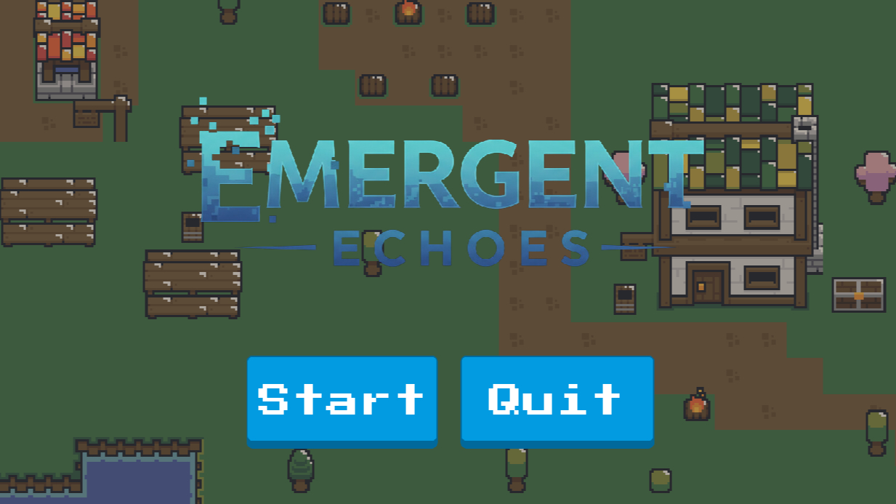
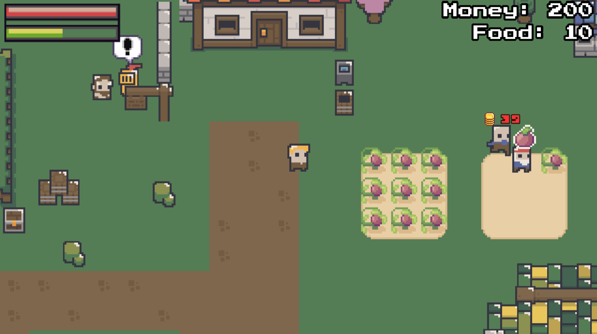

# Emergent Echoes




A 2D island sandbox in Godot where the stories come from the villagers, not from a script. Each NPC tracks a few needs, like food, money, companionship and duty, and picks what to do next from whichever needs are running lowest. A hungry thief steals, a lawful villager chases and jails them, and a friendship forms between two NPCs who keep talking. None of it is authored.

It was our undergraduate thesis at Xavier University - Ateneo de Cagayan, Department of Computer Science, titled *A Resource-Based AI Decision Algorithm for Invoking Narratives Through Non-Playable Characters in a 2D Simulation*. The full paper is at <http://dx.doi.org/10.13140/RG.2.2.16168.48642>.

## Running it

You need Godot 4.4 with .NET (the menu and a few components are C#), and the .NET SDK.

```bash
git clone https://github.com/janrizmlibres/emergent-echoes.git
```

In Godot, choose Import, pick `project.godot`, then press F5. The game opens on the main menu (`Stages/Menu/main_menu.tscn`), and Start fades into the island.

## Controls

| Key | Action |
|---|---|
| WASD | Move |
| K or left click | Attack |
| J | Eat food, or buy food when standing at the shop |
| C | Detach the camera from the player and fly it around to watch the NPCs |

## How it works

Every NPC holds a set of resources (food, money, satiation, companionship and duty), each with a lower and upper threshold. On a random timer, every 10 to 20 seconds, the NPC re-evaluates what to do.

1. **Hunger comes first.** If satiation is below its threshold, the NPC eats if it carries food. Otherwise it shops, or petitions another actor for food or money when it is broke or the shop is empty.
2. **Traits propose actions.** Otherwise each of the NPC's traits (farmer, lawful, thief, survival) offers candidate actions. A candidate's weight grows the further its resource is below the NPC's comfort point, scaled by how strongly the NPC has that trait.
3. **One action wins.** Each candidate survives a roll against its own weight, and the NPC takes the heaviest survivor, breaking ties at random.
4. **A behavior tree runs it.** Each action, like theft, pursuit, harvest or talk, is a [Beehave](https://bitbra.in/beehave/#/) behavior tree under `Utilities/AI/Trees`. Running it moves resources between actors, which changes the next evaluation.

NPCs also remember each other. The memory manager keeps a relationship score per pair of actors, so a thief avoids stealing from someone it trusts. Actors nearby when a crime happens are recorded as witnesses. Lawful NPCs question them, then pursue the criminal and detain them in the prison. An NPC whose satiation runs out keeps taking damage until it eats or dies of hunger, and killing another actor counts as murder.

The player is just another actor in this system. NPCs can petition the player for food or money, and thieves can steal from them.

The core lives in `Utilities/NPCProcGen`. `world_state.gd` and `pcg.gd` are the global singletons, and `Internal/evaluator.gd` holds the decision loop above. Dialogue uses the [Dialogic](https://github.com/dialogic-godot/dialogic) addon.

## Status

Finished as a thesis project, so I'm not taking pull requests. Bug reports and questions are welcome in [Issues](https://github.com/janrizmlibres/emergent-echoes/issues/new).

## Credits

Built with my thesis team.

- Clint Jonathan A. Galendez, 20210021497@my.xu.edu.ph
- Xander Allen M. Rola, 20190016434@my.xu.edu.ph
- David Napoleon L. Romanillos, 20210022695@my.xu.edu.ph

Advised by Jun Rangie C. Obispo, jobispo@xu.edu.ph.

## License

MIT. Copyright (c) 2025 Janriz Mathew Libres, Clint Jonathan A. Galendez, Xander Allen M. Rola, David Napoleon L. Romanillos, Jun Rangie C. Obispo.
